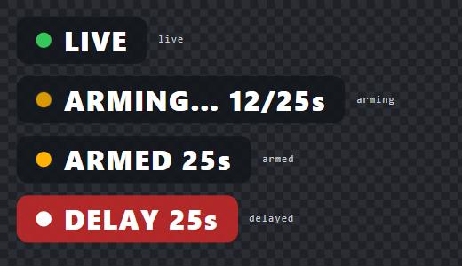
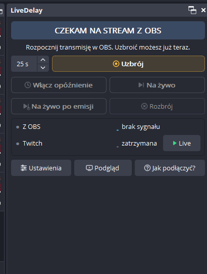
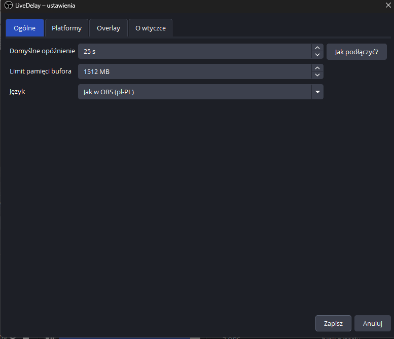
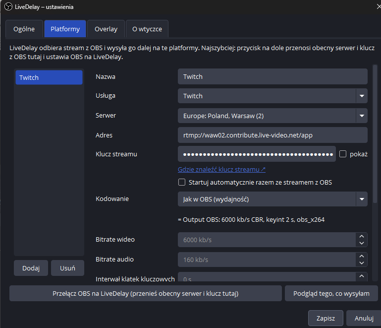
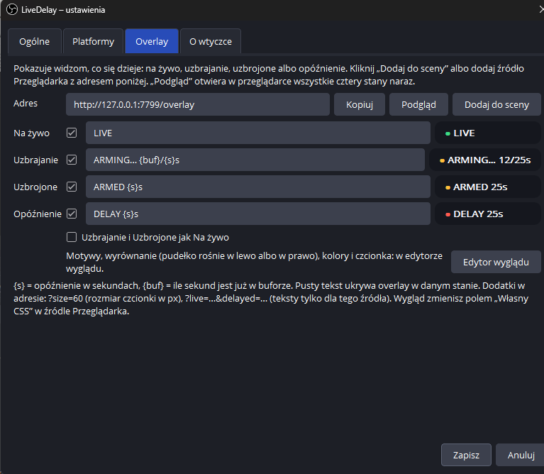
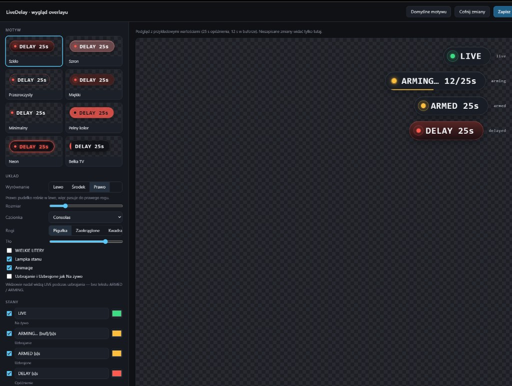

# LiveDelay dla OBS

<sub>[English](README.md) · **Polski**</sub>

**Strona:** [livedelay.vxh.pl](https://livedelay.vxh.pl/) · [EN](https://livedelay.vxh.pl/en/) · [Pobierz](https://github.com/skullboypl/livedelay-obs/releases/latest) · [Hub VXH](https://vxh.pl/livedelay/)

Włączasz i wyłączasz opóźnienie streamu w trakcie nadawania, bez zrywania połączenia. LiveDelay siedzi w OBS między OBS a platformami: **Arm**, potem **Activate**, i widzowie są N sekund z tyłu. **Cut** i są z powrotem na żywo.

- **Jedna wtyczka, bez dodatkowego programu.** Proxy opóźnienia działa w środku OBS (rdzeń w Ruście, ok. 0,1% CPU i 30 MB RAM przy 15 s opóźnienia i 6 Mb/s).
- **Natywny panel.** Okno Qt, nie przeglądarka, więc prawie nic nie kosztuje.
- **Skróty.** Arm, Activate, Cut i „Cut po wyemitowaniu” w Ustawienia → Skróty klawiszowe. Podepniesz je pod numpad albo Stream Deck.
- **Kilka platform naraz.** Twitch, YouTube, Kick, Facebook albo dowolny serwer RTMP/RTMPS - każda z własnym Start / Stop, autostartem, buforem opóźnienia i enkoderem (Auto / Zalecane / Jak w OBS / Ręcznie).
- **Podgląd na żywo.** `/live-preview` pokazuje obok siebie to, co wysyła OBS, i to, co dostają widzowie.
- **Prowadzona konfiguracja.** Instrukcja „Jak podłączyć?”, a panel sam proponuje ustawienie OBS na LiveDelay, jeśli jeszcze nie jest.
- **Overlay.** Źródło Przeglądarka, które pokazuje widzom, co się dzieje: LIVE, ARMING…, ARMED, DELAY 25s.
- **Polski, English, Deutsch, Русский.**



### Zrzuty z OBS

| Dock | Ustawienia · Ogólne | Ustawienia · Platformy |
|:---:|:---:|:---:|
|  |  |  |

| Ustawienia · Overlay | Edytor wyglądu overlayu |
|:---:|:---:|
|  |  |

## Jak to działa

Start Streaming w OBS uruchamia osobny enkoder na każdą platformę do LiveDelay (`rtmp://127.0.0.1:1935/live`, klucze `ld0`, `ld1`, …). Każda platforma ma własny bufor w RAM; Arm / Activate / Cut są wspólne. Stockowy stream OBS idzie na `_idle` i jest odrzucany, żeby przycisk Start dalej działał.

- **Arm** zaczyna trzymać bufor na ustawione opóźnienie.
- **Activate** cofa widzów do klatki kluczowej sprzed co najmniej N sekund. Znaczniki czasu rosną dalej, więc odtwarzacz widzi jeden ciągły stream.
- **Cut** przeskakuje do najnowszej klatki kluczowej: z powrotem na żywo.
- **Cut po wyemitowaniu** zapamiętuje tę chwilę i wraca na żywo, gdy dotrze ona do widzów. Przydaje się po końcu meczu.

## Instalacja

**Jedno polecenie** (PowerShell, zamknij OBS wcześniej):

```powershell
irm https://livedelay.vxh.pl/install.ps1 | iex
```

Wgrywa najnowszy release do `%ProgramData%\obs-studio\plugins\livedelay-obs` (bez admina), wykrywa OBS / Steam / portable.

Potem w OBS: **Narzędzia → LiveDelay** → **Przełącz OBS na LiveDelay** → **Zapisz**. Panel: **Panele → LiveDelay**.

OBS portable:

```powershell
$env:LD_INTO_OBS='1'; $env:LD_OBS_ROOT='D:\sciezka\obs-studio'; irm https://livedelay.vxh.pl/install.ps1 | iex
```

Albo ręcznie: rozpakuj zip → `Install-LiveDelay.ps1`.

Oficjalne buildy mają **podpisany Authenticode (EV)** plik `livedelay-obs.dll`. Jeśli „poniższe wtyczki OBS nie załadowały się”: zły folder, OBS &lt; 31, brak VC++ Redistributable x64, portable bez `-IntoObsFolder`, albo **Smart App Control** blokuje DLL (`LoadLibrary` **4551**). Log: `%AppData%\obs-studio\logs\`.

Wymaga OBS Studio 31+, Windows 10/11 x64.

## Overlay

Dodaj źródło Przeglądarka z adresem `http://127.0.0.1:7799/overlay` (albo kliknij **Dodaj do sceny** w ustawieniach). `http://127.0.0.1:7799/overlay?preview` pokazuje wszystkie stany naraz.

**Edytor wyglądu:** `http://127.0.0.1:7799/edit-theme` (przycisk w ustawieniach) z pięcioma motywami (Szkło, Minimalny, Pełny kolor, Neon, Belka TV), wyrównaniem lewo / środek / prawo (przy prawym pudełko rośnie w lewo), rozmiarem, czcionką, rogami, tłem, kolorami stanów, wielkimi literami, lampką i animacjami, wszystko z podglądem na żywo. Zapis od razu działa na overlayu na streamie.

W ustawieniach każdy stan (Na żywo, Uzbrajanie, Uzbrojone, Opóźnienie) ma przełącznik wł./wył., tekst i mały podgląd. `{s}` to opóźnienie w sekundach, `{buf}` ile sekund jest już w buforze. Opcje dla jednego źródła w adresie: `?size=60`, `?theme=neon`, `?align=right`, `?live=&delayed=OPÓŹNIENIE%20{s}s`. Wygląd jest zapisany w `overlay.json` obok `livedelay.ini`; jego zmiana nigdy nie restartuje streamu.

## Podgląd na żywo

`http://127.0.0.1:7799/live-preview` (przycisk **Podgląd** w panelu) odtwarza obok siebie obraz z OBS i to, co idzie do widzów, więc widać działanie opóźnienia. Ładuje mały odtwarzacz (mpegts.js) z jsDelivr, więc potrzebuje internetu; streamy H.264 działają w każdej przeglądarce.

## Stream Deck i skrypty

Akcja **Hotkey** ze skrótami z OBS albo lokalne API (tylko 127.0.0.1):

| Żądanie | Co robi |
|---|---|
| `POST /arm?delay=15` | zaczyna bufor na 15 s |
| `POST /activate` | włącza opóźnienie |
| `POST /cut` | wraca na żywo teraz |
| `POST /cut-after` | wraca na żywo, gdy ta chwila zostanie wyemitowana |
| `POST /disarm` | zwalnia bufor |
| `POST /dest/start?i=0`, `POST /dest/stop?i=0` | zaczyna albo kończy stream na jednej platformie (0 = pierwsza) |
| `GET /state`, `GET /events` | stan jako JSON albo wypychany jako zdarzenia (SSE) |

Akcje działają też przez GET, więc zadziała akcja **Website** w Stream Decku. Żądania z innych stron WWW są odrzucane, więc żadna strona nie wytnie Ci streamu.

## Ograniczenia

- OBS 31 nie pozwala wtyczkom dodać własnej pozycji w Ustawienia → Transmisja → Usługa, więc LiveDelay używa serwera Własnego (`rtmp://127.0.0.1:1935/live`) i sam go ustawia.
- Enhanced Broadcasting Twitcha to checkbox przy celu Twitch. LiveDelay pyta Twitcha o sesję GoLive i opóźnia tę drabinkę. **Przełącz OBS na LiveDelay** nadal wyłącza własne Enhanced Broadcasting w OBS, bo własny serwer nie ma adresu GoLive.
- Zamknięcie OBS w trybie opóźnienia kończy stream od razu: ostatnie N sekund nie zostanie wyemitowane.
- Zapis ustawień w trakcie streamu uruchamia LiveDelay ponownie i przerywa stream na kilka sekund. Okno pyta o to wcześniej.

## Budowanie

Potrzebne: Visual Studio 2022 (C++), Rust (stable, MSVC) i w `../deps`: źródła obs-studio 31.0.3, Qt 6.6.3 z obs-deps 2024-09-12 oraz biblioteki importu z zainstalowanego OBS.

```
obs-plugin\make-import-libs.ps1
obs-plugin\build.bat
cargo test
package.ps1
```

`install.ps1` instaluje build na tym komputerze bez uprawnień administratora (`%ProgramData%\obs-studio\plugins`). Samodzielna wersja z ikoną w trayu na tym samym rdzeniu: `src/main.rs` (`cargo build --release`).

## Wsparcie

LiveDelay jest darmowy. Jeśli kiedyś uratuje Ci stream: [wesprzyj autora](https://donate.skullmedia.pl). Od tego samego autora: [SmoothWizard](https://smoothwizard.com), FPS booster dla Windows.

## Licencja

GPL-2.0-or-later. Zobacz [LICENSE](LICENSE).
